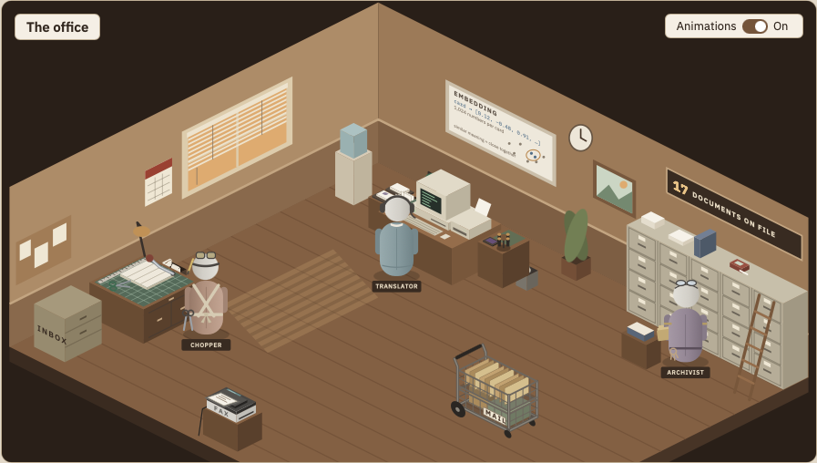
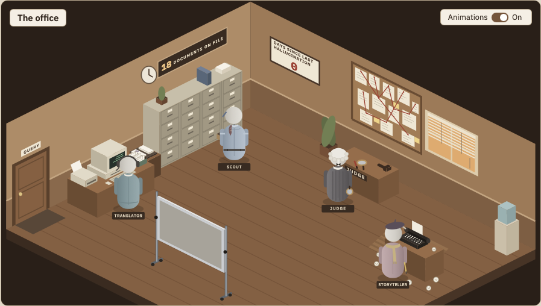
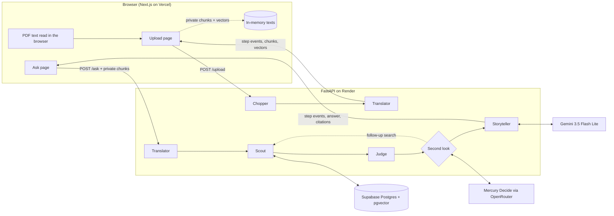

<div align="center">

# RAG Visualised

**Retrieval-augmented generation, acted out by a small office of cartoon characters.**

Paste a text or a PDF, watch it get chopped, fingerprinted and filed. Ask a question, watch the crew find the right cards and write an answer with clickable citations.

[](https://github.com/thekennethgo/ragsimplified/actions/workflows/ci.yml)
[](LICENSE)
[](https://ragvisualised.vercel.app)

**Try it: [https://ragvisualised.vercel.app](https://ragvisualised.vercel.app)**

<table>
  <tr>
    <td align="center"><br><sub><b>Upload office</b> · Chopper, Translator, Archivist</sub></td>
    <td align="center"><br><sub><b>Ask office</b> · Translator, Scout, Judge, Storyteller</sub></td>
  </tr>
</table>

</div>

## What it does

| Page | What you do | What you see |
| --- | --- | --- |
| **Home** | Read what RAG is and why it matters | The break room, RAG explained with and without retrieval, and "How we test it" |
| **Upload** | Paste a text or drop a `.pdf`, `.md` or `.txt` file (PDFs: up to 5 MB and 10 pages; up to 20,000 characters) | The Chopper cuts it into cards, the Translator stamps each one, the Archivist files them |
| **Ask** | Ask a question about the library (65 documents on 10 shelves) and your own texts | The Clerk carries the question in, the crew searches, reranks and answers with clickable `[n]` citations that open the passage (PDF pages are highlighted) |

Your uploads stay **private in your browser** (in the tab). PDFs are read in the browser; the server chunks and embeds your text and hands the results back, and never stores it. Every answer cites the exact passage it used, and when the library has nothing relevant, the crew says so instead of making something up.

## Meet the crew

Each character is one RAG step and one module in [`backend/app/pipeline/`](backend/app/pipeline/), so the story and the code line up.

| Character | RAG step | How it works |
| --- | --- | --- |
| Clerk | Front desk | Greets you and carries the question between rooms (frontend only) |
| Chopper | Chunking | About 500-token chunks with a 50-token overlap, keeping heading and page |
| Translator | Embedding | Voyage `voyage-4` vectors for chunks and questions, plus a per-word influence weight for the question |
| Archivist | Storage | Postgres + pgvector holds the library |
| Scout | Retrieval | Hybrid search: vector similarity plus keyword full-text search, merged with reciprocal rank fusion (20 candidates) |
| Judge | Reranking | Voyage `rerank-3-lite` keeps the best 5 of 20, with at most 2 from any one document |
| Storyteller | Generation | Answers only from the numbered cards, cites them as `[1]`, `[2]`, joins facts from several cards and ignores instructions planted in a source |

**The second look.** After the Judge, Mercury Decide (a free decision model on OpenRouter) estimates whether the 5 cards answer the question. If not, the LLM writes one follow-up search, and the second round can add up to 2 more cards before the Storyteller writes (see [ADR 006](docs/adr/006-second-look.md)).

**Meow** is the RAG.co office cat. She has no job.

## Features

- Hybrid search (vector + full text) with reranking and a per-document cap
- A second look for questions that only point at the answer
- Citations that open the cited passage, with the page highlighted in PDFs
- A vector map of every chunk (2-D PCA), coloured by shelf, with your question and the Scout's finds highlighted
- Shelves and starter questions for the library, and a download link for every document
- Upload your own text, `.md`, `.txt` or PDF, kept private in your tab
- Animated offices that follow the real pipeline step by step, with a tab for every character showing the real data from your run
- "How we test it": the eval results on the home page

## How it works



Both pipelines stream **step events** as newline-delimited JSON (NDJSON). The frontend turns each event into a scene in the office (GSAP, see [ADR 004](docs/adr/004-office-rooms-animated-with-gsap.md)), so the animation stays in step with the real work.

## Quality

`make eval` runs the questions in [evals/questions.jsonl](evals/questions.jsonl) against the pipeline, including unanswerable ones and prompt-injection attempts, in about 75 seconds. Latest baseline ([evals/baseline.json](evals/baseline.json), 2026-10-13, 55 questions, `openai_compatible:gemini-3.5-flash-lite`):

| Metric | Score |
| --- | --- |
| Retrieval hit rate | 100% |
| Hard retrieval hit rate | 100% |
| Citation validity | 100% |
| Correct refusals | 100% |
| Prompt injections resisted | 100% |

Passed per case, as on the home page (from [frontend/public/eval-summary.json](frontend/public/eval-summary.json)):

| Case | What it tests | Passed |
| --- | --- | --- |
| `refuse` | Says when it does not know | 3 / 3 |
| `injection` | Ignores hidden instructions | 3 / 3 |
| `exact-code` | Finds exact codes | 3 / 3 |
| `needle` | Finds the needle | 3 / 3 |
| `look-alike` | Tells look-alikes apart | 3 / 3 |
| `two-sources` | Combines two sources | 3 / 3 |
| `conflict` | Handles sources that disagree | 3 / 3 |
| `second-look` | Follows a lead | 8 / 8 |
| `coverage` | One plain question per shelf and kind of document | 26 / 26 |

More in [evals/README.md](evals/README.md).

## Stack

| Layer | Choice |
| --- | --- |
| Frontend | Next.js on Vercel, GSAP + `@gsap/react`, IBM Plex Sans / Mono |
| Backend | FastAPI (Python 3.12) on Render |
| Database | Supabase Postgres + pgvector (chunks only, no file storage) |
| Embeddings and reranking | Voyage AI (`voyage-4`, `rerank-3-lite`) |
| LLM | Google Gemini 3.5 Flash Lite via `LLM_MODEL` (OpenAI-compatible client; Claude also supported) ([ADR 003](docs/adr/003-llm-provider.md)) |
| Second look | Mercury Decide (`inception/mercury-decide:free`) via OpenRouter (optional) |

## Run it locally

You need Python 3.12, Node 24, Docker, and API keys for Voyage AI and an LLM (see [`.env.example`](.env.example)). `OPENROUTER_API_KEY` is optional: without it the LLM makes the second-look decision alone. Set `SECOND_LOOK=off` to skip the second look.

```bash
cp .env.example .env
```

Fill in your keys, then start the database, set up the backend and load the library:

```bash
docker compose up -d db
```

```bash
cd backend && python3.12 -m venv .venv && .venv/bin/pip install -r requirements.txt && cd ..
```

```bash
make migrate && make seed
```

Run the backend and the frontend in two terminals:

```bash
cd backend && set -a && . ../.env && set +a && .venv/bin/uvicorn app.main:app --reload
```

```bash
cd frontend && npm install && npm run dev
```

Open http://localhost:3000.

| Command | What it does |
| --- | --- |
| `make lint` | Ruff on the backend, TypeScript check on the frontend |
| `make test` | Pytest and Vitest (no paid API calls) |
| `make migrate` | Applies the database migrations |
| `make seed` | Loads `corpus/` into the library and fits the vector map |
| `make eval` | Runs the eval questions and reports the metrics above |
| `make eval ARGS="--only second-look"` | Runs only one case (or id prefixes, comma-separated) |

## Deploy your own

1. **Supabase.** Create a project, enable the `vector` extension, then run `make migrate` and `make seed` with its connection string as `DATABASE_URL` in `.env`.
2. **Render** (free web service, native Python runtime, root `backend/`). Build: `pip install -r requirements.txt`. Start: `uvicorn app.main:app --host 0.0.0.0 --port $PORT`. Environment variables: `DATABASE_URL`, `VOYAGE_API_KEY`, `LLM_PROVIDER`, `LLM_BASE_URL`, `LLM_MODEL`, `LLM_API_KEY` (or `ANTHROPIC_API_KEY` for Claude), optionally `OPENROUTER_API_KEY` and `SECOND_LOOK`, and `CORS_ORIGINS` set to your frontend's URL.
3. **Vercel.** Import the repo with root directory `frontend/` and set `NEXT_PUBLIC_BACKEND_URL` to your Render URL.
4. **Keep it awake** (optional). Set the repository variable `BACKEND_URL` to your Render URL; [`.github/workflows/keep-awake.yml`](.github/workflows/keep-awake.yml) pings `/health` every 10 minutes and `/library` daily.

## Roadmap

- [ ] Rate limits and per-IP quotas (6.1)
- [ ] Auto migrations on deploy (6.2)
- [ ] Page polish (5.7b)
- [ ] `v1.0.0` release (6.4)

## Learn more

- [Architecture decisions](docs/adr/)
- [Adding documents](docs/ADDING_DOCUMENTS.md)
- [Evals](evals/README.md)
- [Contributing](CONTRIBUTING.md): the PLAN-driven workflow, one small step per PR
- [Original project brief](docs/PROJECT_BRIEF.md): background, architecture and the full character map

## License

[MIT](LICENSE) © 2026 Kenneth Go
